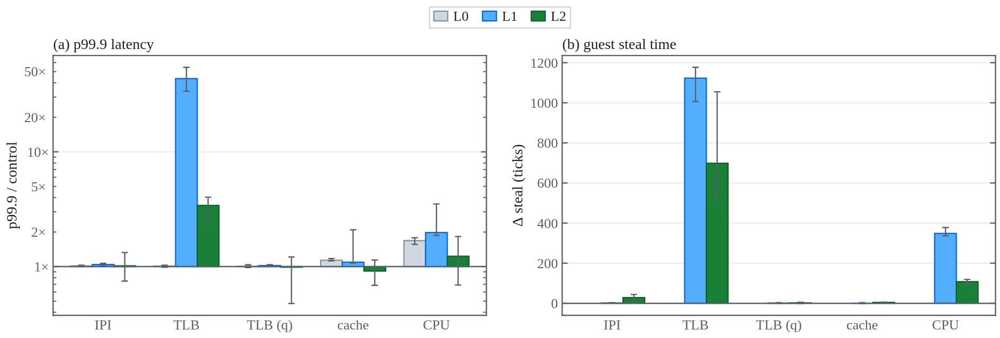

# Tempo

Tempo measures how much of a real-time control loop's deadline-miss tail comes from the system (interrupts, TLB shootdowns, preemption by other work) rather than the computation (the loop's own processing of each frame).

The loop is a four-stage pipeline (sensor, compute, actuator, telemetry), each stage its own process, passing frames over [ImageStreamIO](https://github.com/milk-org/ImageStreamIO) shared memory at a fixed period. A frame that finishes after its deadline is a miss.

### How it measures

The loop runs on the KVM hypervisor (L0), in a guest (L1) or in a guest nested inside it (L2). An injector on L0 loads the loop's cores with IPIs, TLB shootdowns, cache pressure or CPU load. Conditions are compared as ratios against a control.

Each run records L0 IPI and VM exit counts and guest steal time (`/proc/stat`, or ns from `tempo_steal`).

### On Android

Tempo can run the loop as an [Android app](src/android/app/) on a VM booted with [Rhizo](https://github.com/liambilsbury/rhizo), with the CPU load injected inside the VM or on L0.

<!-- results-section begin -->
## Results

From one run on my machine (AMD Ryzen 9 9950X, L0 kernel `7.3.3-1-cachyos`, commit `35d9d3a`), 6 rounds per condition at L0, L1 and L2.



**Figure 1.** p99.9 latency / control (a) and steal time above control (b). CPU load at 44% duty cycle, 10% at L2.


**Figure 2.** Deadline miss ratio under CPU load.

| Median ratio (duty cycle) | L1, 44% | L2, 30% |
|---|---|---|
| Miss ratio, measured margin / 100% | 0 (6/6, p = 0.031) | 0.05 (6/6, p = 0.031) |
| Miss ratio, fixed margin / 100% | 0 (6/6, p = 0.031) | 0.92 (6/6, p = 0.031) |
| p99.9, PREEMPT_RT / non-RT guest kernel (100%, 44%) | 1.04 (1/6, p = 0.22) | n/a |


**Figure 3.** (a) Guest steal / host vCPU run_delay. (b) Host vCPU run_delay / guest runtime lost.


**Figure 4.** CPU load. Medians 0.496 and 0.111: 4.5× (16/16, p = 3.1e-05).

Guest steal, from host vCPU run_delay, misses a median 40% of lost guest runtime. Deadline-bounded work cuts deadline misses 4.5× at a median relative command error of 0.0071.
<!-- results-section end -->

## Build

```bash
bash tools/fetch/dependencies.sh  # -> third_party/ImageStreamIO/
make                              # -> build/pipeline build/inject build/irq_trigger
bash tools/build/guest_kernel.sh  # -> build/kernel-rt/
bash tools/build/make_image.sh    # -> build/l2-initramfs.cpio.gz
bash benchmark/vm/make.sh         # -> build/vm/l1.qcow2
make android-app NDK=... SDK=...  # -> build/android/tempo-loop.apk
```

## Usage

```bash
benchmark/run/experiment.sh --label control --inject none --pin 8,9,10,11  # -> results/experiments/control/
python3 benchmark/run/paired.py --condition control:none --condition hog80:cpu-load:80 --out rounds.json  # -> rounds.json
```

## License

`src/guest/tempo_steal.c` and `kernel/sched-deadline/` are GPL-2.0, see `LICENSES/GPL-2.0.txt`.
