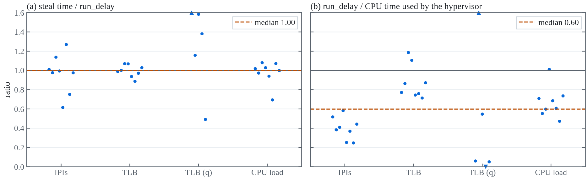
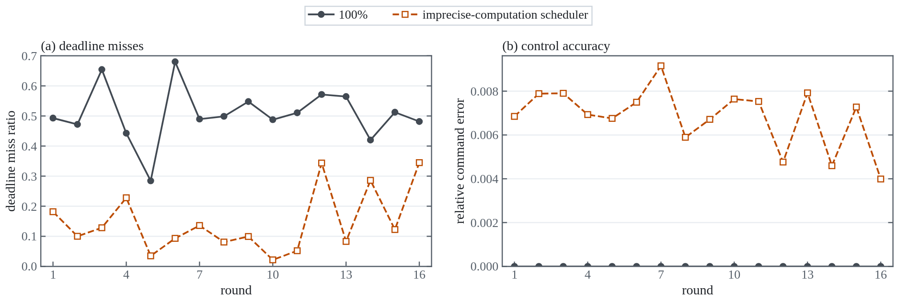
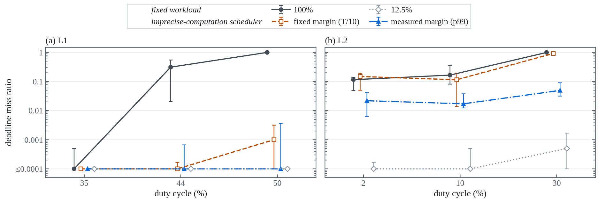

# Tempo

Tempo measures how much of the CPU time used by a hypervisor a real-time guest can observe.

The loop is a four-stage pipeline of processes (sensor, compute, actuator, telemetry) which passes frames over [ImageStreamIO](https://github.com/milk-org/ImageStreamIO) shared memory at a fixed period T. A frame that does not finish the pipeline within T of the sensor stage is considered "a miss".

### How it measures

Tempo runs a control loop in a nested KVM guest (L2) while injecting IPIs, TLB shootdowns, cache pressure, and CPU load from the hypervisor (L0), with a guest (L1) and L0 for comparison. Conditions are compared as ratios against a control.

Each run records the guest's steal time (`/proc/stat`, or ns from `tempo_steal`) and the IPIs and VM exits counted on L0.

### On Android

Tempo can run the loop as an [Android app](src/android/app/) on a VM booted with [Rhizo](https://github.com/liambilsbury/rhizo), with the CPU load injected inside the VM or on L0.

<!-- results-section begin -->
## Results



**Figure 1.** Steal time in a nested KVM guest while injecting IPIs, TLB shootdowns, and CPU load.

- (a) Steal time / vCPU run_delay.
- (b) vCPU run_delay / CPU time used by the hypervisor.

Steal time tracks vCPU run_delay (a, median 1.00), but run_delay covers a median 60% of the CPU time used by the hypervisor (b). So steal time failed to account for about 40% of the CPU time used by the hypervisor.



**Figure 2.** Deadline misses and control accuracy under CPU load.

- (a) Deadline miss ratio per round, 100% and the imprecise-computation scheduler.
- (b) Relative command error per round.

The imprecise-computation scheduler relies on the loop's execution time instead of steal time. It reduced deadline misses by about a factor of 4.5 (16/16, p = 3.1e-05), at a small cost in control accuracy (median relative command error 0.0071).


**Figure 3.** Interference at L0, L1 and L2 while injecting IPIs, TLB shootdowns, cache pressure, and CPU load.

- (a) p99.9 latency / control.
- (b) Steal time above control.

CPU load at 44% duty cycle, 10% at L2. AMD Ryzen 9 9950X, L0 kernel `7.3.3-1-cachyos`, commit `35d9d3a`.



**Figure 4.** Deadline misses under CPU load.

| Median ratio (duty cycle) | L1, 44% | L2, 30% |
|---|---|---|
| Deadline misses, measured margin / 100% | 0 (6/6, p = 0.031) | 0.05 (6/6, p = 0.031) |
| Deadline misses, fixed margin / 100% | 0 (6/6, p = 0.031) | 0.92 (6/6, p = 0.031) |
| p99.9, PREEMPT_RT / non-RT guest kernel (100%, 44%) | 1.04 (1/6, p = 0.22) | n/a |
<!-- results-section end -->

## Build

```bash
bash tools/fetch/dependencies.sh  # -> third_party/ImageStreamIO/
make                              # -> build/pipeline build/inject build/irq_trigger
bash tools/build/guest_kernel.sh  # -> build/kernel-rt/
bash tools/build/make_image.sh    # -> build/l2-initramfs.cpio.gz
bash benchmark/vm/make.sh         # -> build/vm/l1.qcow2
make android-app NDK=... SDK=...  # -> build/android/tempo-loop.apk
```

## Usage

```bash
benchmark/run/experiment.sh --label control --inject none --pin 8,9,10,11  # -> results/experiments/control/
python3 benchmark/run/paired.py --condition control:none --condition hog80:cpu-load:80 --out rounds.json  # -> rounds.json
```

## License

`src/guest/tempo_steal.c` and `kernel/sched-deadline/` are GPL-2.0, see `LICENSES/GPL-2.0.txt`.
